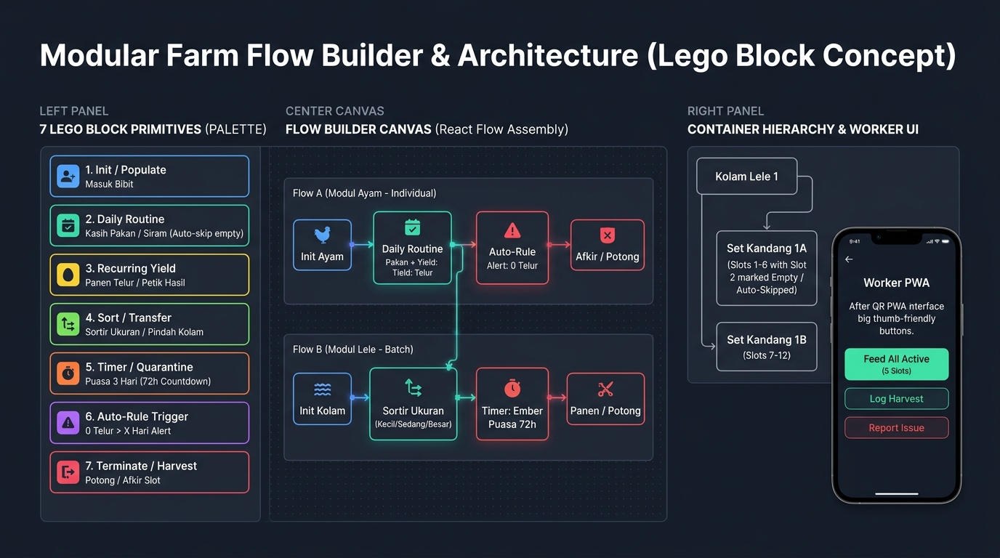

# CymFarm — System Architecture (`ARCHITECTURE.md`)



## 1. Visi & Prinsip Desain Utama
**CymFarm** adalah aplikasi manajemen peternakan & pertanian keluarga berbasis **Next.js PWA (Offline-First)** yang dirancang dengan prinsip **Lego Modular Architecture**:
1. **Dynamic In-App Module Builder**: Jenis peternakan/pertanian baru (Ayam, Lele, Tanaman, Maggot, dll.) dapat dirakit langsung dari dalam aplikasi menggunakan 7 *Lego Block Primitives* di atas kanvas visual (`@xyflow/react`) tanpa perlu koding ulang dari awal.
2. **Pemisahan Ketat antara *Blueprint Flow*, *Container Fisik*, dan *Subject Penghuni***:
   - Mengubah tata letak kandang (upgrade slot, tambah kolam, atau menonaktifkan kandang bocor/maintenance) **tidak akan pernah merusak histori lama** dan tidak mengharuskan pembuatan modul/flow baru.
3. **2 Wajah Antarmuka (Dual-Mode UX)**:
   - **Studio Mode (Admin)**: Tempat merakit modul/flow, mengatur hierarki kandang/kolam, mencetak QR Code, mencatat pembelian pakan, dan melihat analitik (rekomendasi potong ayam afkir & estimasi habis pakan).
   - **Worker Mode (Lapangan / QR Scan)**: Antarmuka *zero-text / big-button* untuk keluarga atau pekerja kandang. Cukup scan QR Set Kandang/Kolam, klik tombol kasih makan (otomatis melewati kandang kosong/maintenance), atau tap nomor kandang yang bertelur hari itu.
4. **Offline-First PWA**: Seluruh aksi harian disimpan seketika ke **IndexedDB (`Dexie.js`)** di perangkat HP dan disinkronkan ke **Supabase PostgreSQL (`Drizzle ORM`)** saat koneksi tersedia.

---

## 2. Struktur Monorepo / Root Wrapper
Seluruh operasional development dikendalikan dari direktori root (`/`):
```text
cymfarm/
├── .env                  # Satu-satunya sumber konfigurasi environment
├── .env.example          # Template environment
├── package.json          # Root wrapper scripts (dev, add, remove, update, env:sync, db:*)
├── ops/                  # Script operasional & CI/CD
│   ├── sync-env.ts       # Otomatis menyinkronkan /.env ke /main/.env.local
│   ├── pkg.ts            # Wrapper install/remove/update package ke /main dari root
│   └── ci.sh             # Pipeline verifikasi CI/CD
├── docs/                 # Dokumentasi proyek
│   ├── ARCHITECTURE.md   # Dokumen arsitektur ini
│   ├── CONTRIBUTION.md   # Panduan kontribusi & operasional dari root
│   └── assets/           # Diagram & aset dokumentasi
└── main/                 # Aplikasi utama Next.js (App Router, Drizzle ORM, Dexie, React Flow)
```

---

## 3. Tujuh Blok Lego Standar (*7 Lego Block Primitives*)
Setiap modul peternakan/tanaman dibangun dengan merangkai node dari 7 tipe blok primitif berikut:

| Kode Blok | Nama Blok | Fungsi & Contoh Penggunaan |
| :--- | :--- | :--- |
| `INIT_POPULATE` | **1. Init / Populate** | Memasukkan penghuni baru ke wadah (Isi Ayam ke Slot Kandang, Tebar Bibit Lele ke Kolam). |
| `DAILY_ROUTINE` | **2. Daily Routine** | Aksi rutin harian seperti Kasih Pakan / Siram. Otomatis melewati (*auto-skip*) slot yang berstatus `VACANT` atau `MAINTENANCE`. |
| `RECURRING_YIELD` | **3. Recurring Yield** | Panen hasil berulang tanpa mengakhiri siklus hidup subjek (Panen Telur Ayam per kandang, Petik Cabai). |
| `SORT_TRANSFER` | **4. Sort / Transfer** | Memindahkan atau memecah populasi antar wadah (Sortir ukuran Lele Kecil/Sedang/Besar atau pindah ke Ember Puasa). |
| `TIMER_QUARANTINE` | **5. Timer / Quarantine** | Fase tunggu dengan hitung mundur otomatis (contoh: **Puasa Lele 3 Hari / 72 Jam** di ember sebelum siap potong). |
| `AUTO_RULE` | **6. Auto-Rule Trigger** | Aturan evaluasi otomatis (contoh: Jika `RECURRING_YIELD` = 0 telur selama `X` hari berturut-turut -> beri status **Rekomendasi Potong/Afkir**). |
| `TERMINATE_HARVEST` | **7. Terminate / Harvest** | Mengakhiri siklus subjek (Potong Ayam / Panen Lele) dan mengubah slot wadah kembali menjadi `VACANT`. |

---

## 4. Desain Skema Database (Drizzle ORM + Supabase PostgreSQL)

Skema database terletak di `main/src/db/schema.ts` dan terdiri dari 5 tabel inti:

1. **`farm_modules` (Blueprint & Flow Definition)**
   - Menyimpan definisi modul dinamis (`Ayam Petelur`, `Lele Konsumsi`, dll.), mode tracking (`INDIVIDUAL` vs `BATCH`), serta struktur graf React Flow (`nodes` dan `edges` dalam kolom `JSONB`).
2. **`containers` (Hierarki Wadah Fisik Dinamis)**
   - Menggunakan self-referencing `parentId` untuk memodelkan struktur fisik apa pun:
     - `Kolam Lele 1` (`type: POND`)
       - `Set Kandang 1A` (`type: CAGE_SET`, `parentId: Kolam 1`)
         - `Kandang 1` s/d `Kandang 6` (`type: CAGE_SLOT`, `parentId: Set 1A`)
     - `Ember Karantina / Puasa` (`type: QUARANTINE_BUCKET`)
   - Memiliki kolom `status`: `'ACTIVE' | 'VACANT' | 'MAINTENANCE' | 'ARCHIVED'`.
   - Jika kolam bocor atau kandang rusak, status diubah ke `'MAINTENANCE'` disertai alur evakuasi penghuni tanpa menghapus histori.
3. **`subjects` (Penghuni Aktif / Historis: Individu Ayam atau Batch Lele)**
   - Merepresentasikan `Ayam #01` (individu di dalam `CAGE_SLOT`) atau `Batch Lele Kolam 1` (komunal di dalam `POND` atau `QUARANTINE_BUCKET`).
   - Menyimpan `currentNodeId` (sedang berada di tahap blok mana pada modul), `timerStartedAt` & `timerEndsAt` (untuk hitung mundur puasa lele 72 jam), serta `consecutiveZeroYieldDays` (untuk deteksi ayam afkir).
4. **`activity_logs` (Log Historis Imutabel)**
   - Mencatat setiap aksi (`FEED`, `EGG_HARVEST`, `SORT_TRANSFER`, `START_FASTING`, `MAINTENANCE_REPORT`, `HARVEST_CUT`).
   - Menyimpan referensi ke `containerId` dan `subjectId` beserta `timestamp`, sehingga meskipun struktur kandang di-upgrade di masa depan, seluruh data historis tetap utuh.
5. **`feed_purchases` (Log Pembelian Pakan & Estimasi Habis)**
   - Mencatat tanggal pembelian pakan, berat dalam kilogram (misal `25 kg`), harga, dan catatan.
   - Tidak memblokir aksi pemberian makan harian pekerja; digunakan untuk menghitung estimasi tanggal habis pakan berdasarkan jumlah ayam aktif dan rata-rata konsumsi historis.
