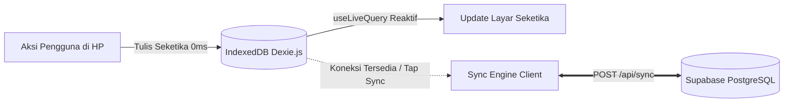

# Arsitektur Sistem & Alur Data CymFarm (`docs/ARCHITECTURE.md`)

Dokumen ini menjelaskan arsitektur teknis, alur data *offline-first*, resolusi konflik, dan mekanisme sinkronisasi cloud pada aplikasi **CymFarm**.

---

## 1. Filosofi Desain: Local-First / Offline-First

Di CymFarm, antarmuka pengguna (UI di Lapangan, Riwayat, maupun Admin) **100% membaca dan menulis langsung ke IndexedDB (Dexie.js)** di perangkat pengguna, **BUKAN** langsung memanggil API Supabase.



### Keunggulan Arsitektur:
1. **Zero Latency (0ms)**: Tidak ada loading spinner saat pekerja menekan tombol kasih pakan atau panen di lapangan.
2. **Kekebalan Lapangan**: Bekerja 100% tanpa gangguan di area kandang atau kebun yang tidak memiliki sinyal internet.
3. **PWA Standalone Shell**: Seluruh aset static (HTML, CSS, JS) disimpan di browser via Service Worker (`public/sw.js`).

---

## 2. Struktur Monorepo & Root Wrapper

Semua operasional dikendalikan dari root repository menggunakan script orchestrator:

```text
cymfarm/
├── .env                  # Satu-satunya sumber konfigurasi environment (Supabase URL, Key, dll.)
├── .env.example          # Template konfigurasi
├── package.json          # Root wrapper scripts (dev, build, start, add, remove, db:*)
├── ops/                  # Skrip otomatisasi & migrasi
│   ├── sync-env.ts       # Menyinkronkan /.env ke /main/.env.local secara otomatis
│   ├── pkg.ts            # Wrapper manajemen package di sub-direktori /main
│   ├── migrate.ts        # Database migration orchestrator (pre-flight checks, extensions, Drizzle migrator)
│   └── ci.sh             # Pipeline verifikasi CI/CD
├── docs/                 # Dokumentasi sistem & use case
│   ├── ARCHITECTURE.md   # Dokumen arsitektur ini
│   ├── USE_CASE.md       # Alur operasional & skenario lapangan
│   └── CONTRIBUTION.md   # Panduan kontribusi & development commands
└── main/                 # Aplikasi Next.js App Router (PWA, Dexie.js, Drizzle ORM)
    ├── public/
    │   ├── manifest.json # Web App Manifest PWA
    │   ├── sw.js         # Service Worker offline cache
    │   ├── icon.svg      # Master SVG icon
    │   ├── icon-192.png  # PWA standard Android icon (192px)
    │   └── icon-512.png  # PWA splash screen icon (512px)
    └── src/
        ├── app/          # Next.js App Router (/lapangan, /riwayat, /admin, /login, /api/sync)
        ├── components/   # ModularWorkerView, AdminModularStudio, AppShell, QrScanner, etc.
        ├── db/           # Drizzle ORM schema & client
        └── lib/          # offline-db.ts, sync-engine.ts, activity-undo.ts
```

---

## 3. Skema Database Inti (PostgreSQL via Drizzle ORM)

Skema database terletak di `main/src/db/schema.ts` dan terdiri dari tabel-tabel terstruktur:

1. **`farm_module_categories`**:
   - Kategori modular dinamis (`LIVESTOCK`, `AQUACULTURE`, `PLANT`, `FUNGI`, dll.) lengkap dengan icon emoji yang dapat ditambah mandiri oleh admin.
2. **`farm_modules`**:
   - Blueprint sistem ternak modular. Menyimpan nama modul, kategori, mode tracking (`BATCH` vs `INDIVIDUAL`), serta konfigurasi modular (`ModularFarmConfig`):
     - `routineActionLabel`: Label tombol perawatan harian (misal: "Kasih Pakan", "Semprot Air").
     - `harvestType`: `'RECURRING'` (berkala seperti telur/jamur) atau `'ONCE'` (sekali panen habis seperti lele/sayur).
     - `harvestActionLabel` & `harvestUnitLabel`: Label tombol panen dan satuan (butir/kg/ikat).
     - `harvestAlertDays`: Ambang batas hari keterlambatan panen sebelum memicu visual highlight peringatan (isi `0` untuk menonaktifkan alert pada komoditas siklus lama seperti kambing/sapi).
3. **`containers`**:
   - Wadah fisik nyata di farm (kandang baterai, petak kolam, rak kumbung jamur, dll.).
   - Menyimpan `code` (slug unik untuk QR code), `capacity`, dan `status` (`'ACTIVE' | 'VACANT' | 'MAINTENANCE'`).
4. **`subjects`**:
   - Subjek populasi penghuni wadah. Menyimpan `populationCount`, `isActive`, `lastRoutineDate`, dan `lastHarvestDate`.
5. **`activity_logs`**:
   - Buku jurnal aktivitas historis lapangan (`ROUTINE`, `HARVEST`, `POPULATION_CHANGE`, `MAINTENANCE`, `TERMINATE`, `CREATE`).
   - Menyimpan referensi wadah, subjek, kuantitas, catatan, dan timestamp ISO `performedAt`.

---

## 4. Alur Sinkronisasi & Resolusi Konflik (Sync Engine)

Sinkronisasi dua arah dikendalikan oleh `main/src/lib/sync-engine.ts` dan endpoint `main/src/app/api/sync/route.ts`:

### A. Push (Klien ke Cloud)
1. Klien memfilter log lokal yang belum disinkronkan (`syncedToCloud: false`).
2. Klien mengirim antrean log beserta snapshot modul, kategori, wadah, dan subjek lokal ke server via `POST /api/sync`.
3. Server PostgreSQL melakukan:
   - `activityLogs.insert().onConflictDoNothing()` (id berbasis timestamp client unik).
   - `farmModules`, `containers`, `subjects` di-upsert dengan prinsip **Last-Write-Wins (LWW)** berdasarkan `updatedAt`.
   - Jika ada log `TERMINATE` pada suatu wadah, wadah tersebut dihapus dari database fisik.

### B. Pull & Pruning (Cloud ke Klien)
1. Server mengembalikan seluruh snapshot master dari Supabase.
2. Klien membuka **IndexedDB Atomic Transaction**:
   - Log lokal yang berhasil terkirim ditandai `syncedToCloud = true`.
   - **Anti-Zombie Pruning**: Jika suatu wadah atau modul lokal telah dihapus di cloud oleh perangkat lain, IndexedDB menghapusnya secara lokal agar tidak dibangkitkan kembali.
   - Meng-update record lokal dengan data master awan.

### C. Pembatalan Terintegrasi (Undo Rollback)
Jika user membatalkan aksi via tombol **Undo** (baik dari notifikasi toast maupun halaman `/riwayat`):
1. `activity-undo.ts` menghapus log dari IndexedDB dan mengembalikan status populasi atau tanggal panen ke kondisi sebelumnya.
2. Jika record tersebut sudah terlanjur tersinkronisasi ke cloud, klien otomatis memanggil `POST /api/sync/undo` untuk menghapus baris log tersebut di Supabase PostgreSQL.

---

## 5. PWA & Service Worker Offline Caching

1. **`main/public/manifest.json`**:
   - Mendaftarkan nama aplikasi, mode `standalone`, tema warna `#10b981`, serta icon standar `icon-192.png` dan `icon-512.png`.
2. **`main/public/sw.js`**:
   - Menyimpan cache static shell (`/`, `/lapangan`, `/riwayat`, `/login`, CSS, JS).
   - Strategi `Stale-While-Revalidate` untuk aset tampilan (instan dari cache, perbarui di latar belakang jika online).
   - Seluruh endpoint API (`/api/*`) di-bypass dari cache agar ditangani secara native oleh IndexedDB.
3. **`PwaInstallPrompt.tsx`**:
   - Dialog mengambang ramah awam yang memandu pengguna memasang aplikasi ke layar utama HP dengan jeda tunda (*24-hour snooze*) jika ditutup sementara.
