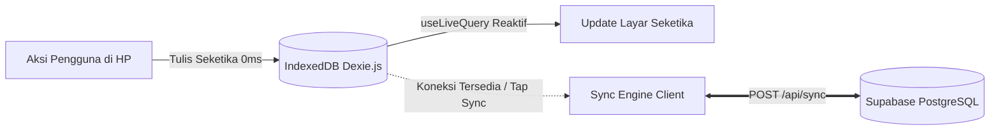

# Arsitektur Sistem & Alur Data CymFarm (`docs/ARCHITECTURE.md`)

Dokumen ini menjelaskan arsitektur teknis, alur data *offline-first*, resolusi konflik, dan mekanisme sinkronisasi cloud pada aplikasi **CymFarm**.

---

## 1. Filosofi Desain: Local-First / Offline-First

Di CymFarm, antarmuka pengguna (UI di Lapangan, Riwayat, maupun Admin) **100% membaca dan menulis langsung ke IndexedDB (Dexie.js)** di perangkat pengguna, **BUKAN** langsung memanggil API Supabase.



### Keunggulan Arsitektur:
1. **Zero Latency (0ms)**: Tidak ada loading spinner saat pekerja menekan tombol kasih pakan atau panen di lapangan.
2. **Kekebalan Lapangan**: Bekerja 100% tanpa gangguan di area kandang atau kebun yang tidak memiliki sinyal internet.
3. **PWA Standalone Shell**: Seluruh aset static (HTML, CSS, JS) disimpan di browser via Service Worker (`public/sw.js`).

---

## 2. Struktur Monorepo & Root Wrapper

Semua operasional dikendalikan dari root repository menggunakan script orchestrator:

```text
cymfarm/
├── .env                  # Satu-satunya sumber konfigurasi environment (Supabase URL, Key, dll.)
├── .env.example          # Template konfigurasi
├── package.json          # Root wrapper scripts (dev, build, start, add, remove, db:*)
├── ops/                  # Skrip otomatisasi & migrasi
│   ├── sync-env.ts       # Menyinkronkan /.env ke /main/.env.local secara otomatis
│   ├── pkg.ts            # Wrapper manajemen package di sub-direktori /main
│   ├── migrate.ts        # Database migration orchestrator (pre-flight checks, extensions, Drizzle migrator)
│   └── ci.sh             # Pipeline verifikasi CI/CD
├── docs/                 # Dokumentasi sistem & use case
│   ├── ARCHITECTURE.md   # Dokumen arsitektur ini
│   ├── USE_CASE.md       # Alur operasional & skenario lapangan
│   └── CONTRIBUTION.md   # Panduan kontribusi & development commands
└── main/                 # Aplikasi Next.js App Router (PWA, Dexie.js, Drizzle ORM)
    ├── public/
    │   ├── manifest.json # Web App Manifest PWA
    │   ├── sw.js         # Service Worker offline cache
    │   ├── icon.svg      # Master SVG icon
    │   ├── icon-192.png  # PWA standard Android icon (192px)
    │   └── icon-512.png  # PWA splash screen icon (512px)
    └── src/
        ├── app/          # Next.js App Router (/lapangan, /riwayat, /admin, /login, /api/sync)
        ├── components/   # ModularWorkerView, AdminModularStudio, AppShell, QrScanner, etc.
        ├── db/           # Drizzle ORM schema & client
        └── lib/          # offline-db.ts, sync-engine.ts, activity-undo.ts
```

---

## 3. Skema Database Inti (PostgreSQL via Drizzle ORM)

Skema database terletak di `main/src/db/schema.ts` dan terdiri dari tabel-tabel terstruktur:

1. **`farm_module_categories`**:
   - Kategori modular dinamis (`LIVESTOCK`, `AQUACULTURE`, `PLANT`, `FUNGI`, dll.) lengkap dengan icon emoji yang dapat ditambah mandiri oleh admin.
2. **`farm_modules`**:
   - Blueprint sistem ternak modular. Menyimpan nama modul, kategori, mode tracking (`BATCH` vs `INDIVIDUAL`), serta konfigurasi modular (`ModularFarmConfig`):
     - `routineActionLabel`: Label tombol perawatan harian (misal: "Kasih Pakan", "Semprot Air").
     - `harvestType`: `'RECURRING'` (berkala seperti telur/jamur) atau `'ONCE'` (sekali panen habis seperti lele/sayur).
     - `harvestActionLabel` & `harvestUnitLabel`: Label tombol panen dan satuan (butir/kg/ikat).
     - `harvestAlertDays`: Ambang batas hari keterlambatan panen sebelum memicu visual highlight peringatan (isi `0` untuk menonaktifkan alert pada komoditas siklus lama seperti kambing/sapi).
3. **`containers`**:
   - Wadah fisik nyata di farm (kandang baterai, petak kolam, rak kumbung jamur, dll.).
   - Menyimpan `code` (slug unik untuk QR code), `capacity`, dan `status` (`'ACTIVE' | 'VACANT' | 'MAINTENANCE'`).
4. **`subjects`**:
   - Subjek populasi penghuni wadah. Menyimpan `populationCount`, `isActive`, `lastRoutineDate`, dan `lastHarvestDate`.
5. **`activity_logs`**:
   - Buku jurnal aktivitas historis lapangan (`ROUTINE`, `HARVEST`, `POPULATION_CHANGE`, `MAINTENANCE`, `TERMINATE`, `CREATE`).
   - Menyimpan referensi wadah, subjek, kuantitas, catatan, dan timestamp ISO `performedAt`.

---

## 4. Alur Sinkronisasi & Resolusi Konflik (Incremental Sync Engine)

Sinkronisasi dua arah dikendalikan oleh `main/src/lib/sync-engine.ts` dan endpoint `main/src/app/api/sync/route.ts`:

### A. Incremental Push (Klien ke Cloud)
1. Klien hanya memfilter data lokal yang baru dibuat atau diubah (`syncedToCloud: false`):
   - Entitas: `farmModules`, `containers`, `subjects`, `feedPurchases`.
   - Log: `activityLogs` (Pure Append-Only).
2. Klien mengirim data baru tersebut beserta timestamp `lastPulledAt` ke server via `POST /api/sync`.
3. Server PostgreSQL melakukan:
   - `activityLogs.insert().onConflictDoNothing()` (id berbasis timestamp client unik).
   - `farmModules`, `containers`, `subjects` di-upsert dengan prinsip **Last-Write-Wins (LWW)** berdasarkan `updatedAt`.
   - **Soft Delete**: Penghapusan wadah atau modul hanya mengisi `deleted_at = NOW()`, sehingga baris tetap ada di cloud dan tidak merusak integritas foreign key maupun log historis.

### B. Incremental Pull & State Replay (Cloud ke Klien)
1. **Delta Query**: Server hanya mengembalikan baris yang memiliki `updatedAt > lastPulledAt` (atau `performedAt > lastPulledAt` untuk activity logs).
2. **Payload Ringan**: Jika tidak ada perubahan baru dari perangkat lain, respons dari server berukuran sangat kecil (< 1 KB) dan selesai dalam sub-detik (< 300ms).
3. **Action Replay Reducer**:
   Ketika klien menerima log aktivitas baru dari cloud, sistem di IndexedDB **langsung menerapkan aksi fisik ke wadah & subjek lokal**:
   - Log `ROUTINE` -> Mengupdate `lastRoutineDate` subjek -> Tombol pakan langsung berubah hijau hari ini di layar perangkat lain.
   - Log `HARVEST` -> Mengupdate `lastHarvestDate` subjek.
   - Log `POPULATION_CHANGE` -> Menyetel `populationCount` ke nilai mutlak target.
   - Log `TERMINATE` -> Mengubah status wadah menjadi `VACANT` dan subjek `isActive = false`.

### C. Pembatalan Terintegrasi (Append-Only Undo di Lapangan)
1. **Tidak Ada Hard Delete pada Log**: Aksi Undo **tidak menghapus baris lama** dari tabel riwayat.
2. **Mencatat Event Undo Baru**: Sistem menambahkan log baru bertipe `activityType: 'UNDO'` dan membatalkan status wadah/subjek ke kondisi sebelumnya.
3. **Pemberian Tombol di Lapangan**: Tombol Undo tersedia langsung di kartu wadah lapangan (tepat di bawah tombol pakan/panen) dan di notifikasi toast, sehingga pekerja dapat membatalkan aksi salah pencet tanpa harus membuka halaman `/riwayat`.

---

## 5. PWA & Service Worker Offline Caching

1. **`main/public/manifest.json`**:
   - Mendaftarkan nama aplikasi, mode `standalone`, `start_url: "/lapangan"`, serta icon standar `icon-192.png` dan `icon-512.png`.
2. **`main/public/sw.js` (Cache v3)**:
   - Menyimpan cache static shell (`/lapangan`, `/riwayat`, `/login`, CSS, JS chunks Next.js).
   - **Auto-caching Chunks**: Semua file static bundle Next.js (`/_next/static/*`) otomatis di-cache saat online.
   - **Offline Navigation Fallback**: Jika perangkat offline total dan aplikasi di-restart, Service Worker langsung menyajikan shell `/lapangan` dari cache lokal.
   - Seluruh endpoint API (`/api/*`) di-bypass dari cache agar ditangani secara native oleh IndexedDB.
3. **`PwaInstallPrompt.tsx`**:
   - Dialog mengambang ramah awam yang memandu pengguna memasang aplikasi ke layar utama HP dengan jeda tunda (*24-hour snooze*) jika ditutup sementara.
