# Alur Penggunaan & Skenario Lapangan CymFarm (`docs/USE_CASE.md`)

Dokumen ini menjelaskan alur operasional nyata aplikasi **CymFarm** untuk **Admin** dan **User (Keluarga / Pekerja Lapangan)**, mencakup operasional harian, scanning QR code, penyesuaian populasi, dan fitur pembatalan aksi (Undo).

---

## 1. Peran Pengguna (Role Scope)

| Aspek | User / Pekerja Lapangan | Admin (Pemilik Farm) |
| :--- | :--- | :--- |
| **Akses Halaman** | `/lapangan` dan `/riwayat` | Semua (`/lapangan`, `/riwayat`, dan `/admin`) |
| **Tujuan Utama** | Operasional harian cepat tanpa beban kognitif | Desain modul baru, konfigurasi tombol, cetak QR code, & pengawasan |
| **Interaksi Utama** | Tap tombol pakan/rawat, tap panen, scan QR kandang, update populasi | Buat/edit modul, tambah wadah baru, setel threshold alert panen, kelola kategori |
| **Konektivitas** | 100% Offline-ready di kandang | Offline-ready + sinkronisasi cloud ke Supabase |

---

## 2. Use Case Diagram (Mermaid)

```mermaid
flowchart TD
    %% Actors
    Admin(["👤 Admin (Pemilik Farm)"])
    User(["👥 User (Keluarga / Pekerja Lapangan)"])

    %% Subsystem Boundary
    subgraph CymFarmApp["Sistem Aplikasi CymFarm (PWA Offline-First)"]
        %% Autentikasi & Navigasi
        UC_Login["1. Masuk Akun (Admin / Keluarga)"]
        UC_ScanQR["2. Scan QR Stiker Kandang via Kamera / Upload File"]
        UC_GridSelector["3. Buka Semua Kandang (Grid Selector Warna Status)"]

        %% Operasional Lapangan
        subgraph Lapangan["Modul Lapangan (/lapangan)"]
            UC_Routine["4. Eksekusi Perawatan Harian (Kasih Pakan / Siram)"]
            UC_Harvest["5. Catat Panen (Berkala / Sekali Habis)"]
            UC_Populasi["6. Update Jumlah Ternak (Set Nilai Pasti LWW)"]
            UC_UndoField["7. Batalkan Aksi (Quick Undo) Langsung di Kartu Lapangan / Toast"]
            UC_LaporRusak["8. Lapor Kendala / Kerusakan Wadah Fisik"]
        end

        %% Riwayat & Audit
        subgraph Riwayat["Modul Riwayat Aktivitas (/riwayat)"]
            UC_SearchLog["9. Cari Catatan Aktivitas & Filter Pill (Rawat, Panen, Populasi, Kendala, Undo)"]
        end

        %% Admin Studio
        subgraph AdminOnly["Modul Admin Studio (/admin)"]
            UC_CreateModule["11. Buat / Edit Sistem Ternak (Form 4 Kotak)"]
            UC_SetThreshold["12. Setel Ambang Batas Alert Hari Panen (0 = Mati)"]
            UC_AddContainer["13. Tambah Wadah Fisik Baru per Modul"]
            UC_PrintQR["14. Unduh PNG & Cetak Stiker QR Kandang"]
            UC_ManageCategory["15. Kelola Kategori Modul Dinamis (Emoji)"]
            UC_SyncCloud["16. Sinkronisasi Data Manual ke Supabase"]
        end
    end

    %% Relasi User
    User --> UC_Login
    User --> UC_ScanQR
    User --> UC_GridSelector
    User --> UC_Routine
    User --> UC_Harvest
    User --> UC_Populasi
    User --> UC_UndoField
    User --> UC_LaporRusak
    User --> UC_SearchLog

    %% Relasi Admin (Mewarisi seluruh fungsi User + fungsi khusus Admin)
    Admin --> UC_Login
    Admin --> UC_CreateModule
    Admin --> UC_SetThreshold
    Admin --> UC_AddContainer
    Admin --> UC_PrintQR
    Admin --> UC_ManageCategory
    Admin --> UC_SyncCloud
```

---

## 3. Skenario & Alur Operasional Nyata

### A. Alur Pekerja di Depan Kandang (Quick Routine via QR)
1. Pekerja membawa HP ke kandang tanpa koneksi internet.
2. Membuka aplikasi CymFarm langsung dari icon layar utama HP (PWA).
3. Menekan tombol **`Scan QR`** di tengah navbar bawah (atau tap `Buka Semua Kandang`).
4. Mengarahkan kamera ke stiker QR di depan kandang -> Layar seketika melompat ke kandang tersebut.
5. Menekan tombol hijau raksasa **`Kasih Pakan`**:
   - Counter bertambah: *"Sudah 1x hari ini • Terakhir: 07:30 WIB"*.
   - Muncul notifikasi toast dengan tombol **`[ Batalkan (Undo) ]`**.

### B. Alur Panen Hasil & Visual Highlight
1. Saat memanen (telur ayam, jamur tiram, cabai, dll.), pekerja menekan tombol kuning **`Panen Hasil`**.
2. Masukkan jumlah panen menggunakan tombol sentuh `+` / `-` yang besar.
3. Klik **Simpan Panen**.
4. **Deteksi Otomatis Keterlambatan Panen**:
   - Jika kandang bertipe panen berkala belum pernah dipanen selama melewati batas `harvestAlertDays` (misal > 2 hari):
     - Tombol panen otomatis **berkedip lembut (`pulse`)** dengan border merah dan badge **`⚠️ 3 Hari Belum Panen`**.
   - Untuk komoditas penggemukan siklus panjang (kambing, sapi, kolam pembesaran) dengan threshold `0`:
     - Teks tetap netral: *"Terakhir: Belum pernah panen"* tanpa alarm peringatan palsu.

### C. Alur Penyesuaian Populasi (Update Ternak)
1. Jika peternak membeli 20 ekor bibit baru atau memotong 2 ekor ayam untuk makan malam:
2. Di kartu populasi lapangan, klik tombol **`Update Jumlah Ternak / Bibit`**.
3. Pilih opsi aksi:
   - **`+ Tambah`**: Menambah stok bibit baru.
   - **`- Kurangi`**: Mengurangi ternak yang dipotong / mati / dijual.
   - **`Atur Total`**: Mengoreksi total populasi berdasarkan penghitungan ulang fisik.
4. Perubahan otomatis tercatat ke riwayat dengan badge khusus **`📊 Populasi`**.

### D. Alur Pembatalan Aksi (Undo)
Jika pekerja tidak sengaja memencet tombol atau salah memasukkan angka panen:
- **Cara 1 (Seketika)**: Tekan tombol **`[ Batalkan (Undo) ]`** pada popup notifikasi yang tampil selama 6 detik.
- **Cara 2 (Belakangan)**: Masuk ke halaman **Riwayat (`/riwayat`)** -> cari catatan yang salah -> klik tombol **`[ Undo ]`**.
- Status kandang, tanggal panen, atau populasi otomatis dikembalikan ke kondisi tepat sebelum aksi dilakukan.

### E. Alur Admin (Membuat Komoditas Baru & Menempelkan QR)
1. Buka menu **Admin Studio** via ikon gerigi di header atas atau menu samping.
2. Klik tombol **`+ Buat Sistem Ternak Baru`**:
   - Kotak 1: Tentukan nama (misal *"Jamur Tiram Kumbung"*) dan kategori (*"🍄 Jamur & Fungi"*).
   - Kotak 2: Daftarkan wadah pertama (*"Rak Kumbung A"* & kode *"RAK-A"*).
   - Kotak 3: Tentukan label tombol rawat (*"Semprot Kabut Air"*).
   - Kotak 4: Tentukan panen berkala (*"Petik Jamur"*, satuan *"Kg"*, threshold alert *"1 Hari"*).
3. Klik **Simpan Sistem Ternak**.
4. Di kartu modul, klik tombol **`QR`** pada wadah yang baru dibuat:
   - Klik **`Unduh PNG`** untuk menyimpan gambar QR berlabel rapi, atau klik **`Cetak (Print)`** untuk mencetak ke stiker laminasi fisik.
   - Tempelkan stiker di rak kandang. Pekerja langsung bisa scan dan bekerja!
