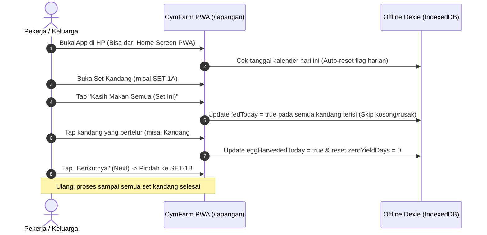
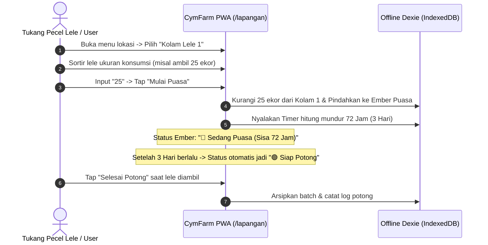
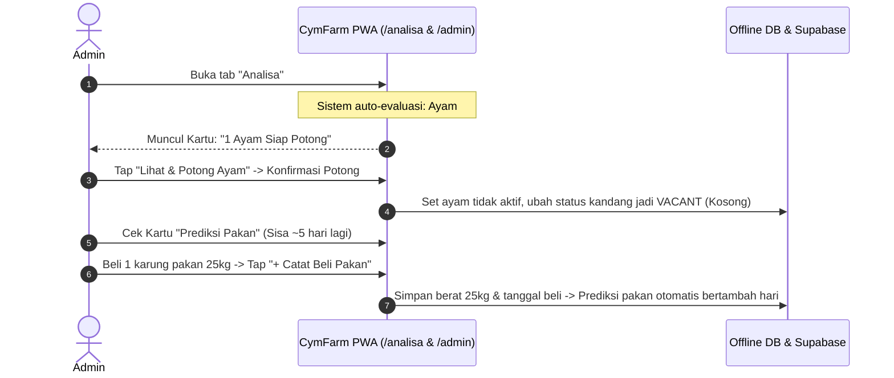
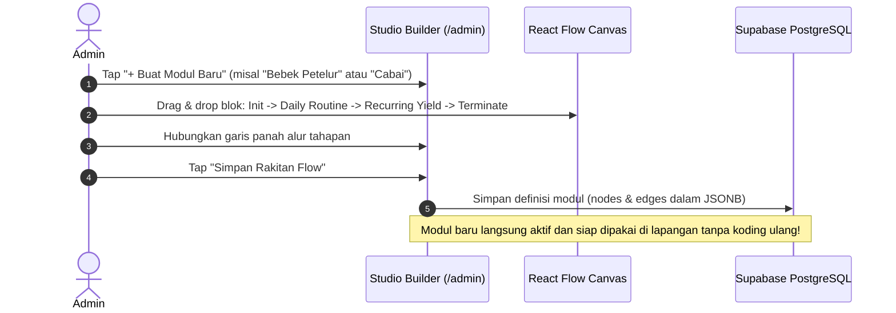

# Alur Penggunaan & Use Case Diagram CymFarm (`docs/USE_CASE.md`)

Dokumen ini menjelaskan alur operasional nyata aplikasi **CymFarm** untuk **Admin** dan **User (Keluarga / Pekerja Lapangan)**, baik saat menggunakan database lokal offline-first (IndexedDB) maupun sinkronisasi cloud ke Supabase PostgreSQL.

---

## 1. Perbedaan Peran Pengguna (Role Scope)

| Aspek | User / Pekerja Lapangan | Admin (Pemilik Peternakan) |
| :--- | :--- | :--- |
| **Akses Halaman** | `/lapangan` dan `/analisa` | Semua (`/lapangan`, `/analisa`, dan `/admin`) |
| **Tujuan Utama** | Operasional harian cepat tanpa ribet | Manajemen layout, perakitan alur modul baru, & kontrol stok |
| **Interaksi Khas** | Tap tombol makan harian, tap panen telur, mulai puasa lele, lapor kandang rusak | Rakit alur 7 Lego Block, tambah slot kandang, pantau prediksi pakan & eksekusi afkir ayam |
| **Konektivitas** | 100% Offline-ready (tetap bisa input di kandang tanpa sinyal) | Terhubung ke cloud untuk push skema & setup modul |

---

## 2. Use Case Diagram (Mermaid)

```mermaid
flowchart TD
    %% Actors
    Admin(["👤 Admin (Pemilik Farm)"])
    User(["👥 User (Keluarga / Pekerja)"])

    %% Subsystem Boundary
    subgraph CymFarmApp["Sistem Aplikasi CymFarm"]
        %% Autentikasi
        UC_Login["1. Masuk Akun via .env (Admin / Keluarga)"]
        UC_Logout["2. Keluar Akun (Sticky di Sidebar)"]

        %% Modul Lapangan
        subgraph Lapangan["Modul Lapangan (/lapangan)"]
            UC_NavLokasi["3. Navigasi Cepat Lokasi (Prev / Next / Sidebar)"]
            UC_FeedAll["4. Kasih Makan Semua di Set Kandang (Auto-skip Kosong/Rusak)"]
            UC_ToggleEgg["5. Catat / Batal Panen Telur per Kandang"]
            UC_FeedSingle["6. Catat Pakan Manual per Kandang"]
            UC_PopulateVacant["7. Masukkan Hewan / Ayam Baru ke Kandang Kosong"]
            UC_LaporRusak["8. Lapor Kandang Rusak / Bocor & Evakuasi Hewan"]
            UC_SelesaiPerbaikan["9. Konfirmasi Kandang Selesai Diperbaiki"]
            UC_SortirLele["10. Sesuaikan Populasi Hasil Sortir Kolam Lele"]
            UC_MulaiPuasa["11. Pindahkan Lele ke Ember & Mulai Puasa 3 Hari"]
            UC_PotongLele["12. Selesai Potong Lele setelah 3 Hari Puasa"]
        end

        %% Modul Analisa & Logistik
        subgraph Analisa["Modul Analisa & Logistik (/analisa)"]
            UC_CekAfkir["13. Pantau Ayam Stop Bertelur >= 7 Hari"]
            UC_PotongAfkir["14. Eksekusi Potong Ayam Afkir (Otomatis Kosongkan Slot)"]
            UC_PrediksiPakan["15. Pantau Prediksi Tanggal Habis Pakan Karungan"]
            UC_BeliPakan["16. Catat Pembelian Pakan Baru (25 KG)"]
            UC_RiwayatPakan["17. Lihat Riwayat Beli Pakan Sebelumnya"]
            UC_CekLog["18. Lihat Catatan Aktivitas Lapangan"]
        end

        %% Modul Khusus Admin
        subgraph AdminOnly["Modul Khusus Admin (/admin)"]
            UC_RakitFlow["19. Rakit Alur Modul Baru dengan 7 Lego Block"]
            UC_UpgradeKandang["20. Upgrade Slot Kandang Baru (Tanpa Rusak Histori)"]
            UC_SyncCloud["21. Sinkronisasi Skema & Data ke Supabase Postgres"]
        end
    end

    %% Relasi User
    User --> UC_Login
    User --> UC_Logout
    User --> UC_NavLokasi
    User --> UC_FeedAll
    User --> UC_ToggleEgg
    User --> UC_FeedSingle
    User --> UC_PopulateVacant
    User --> UC_LaporRusak
    User --> UC_SelesaiPerbaikan
    User --> UC_SortirLele
    User --> UC_MulaiPuasa
    User --> UC_PotongLele
    User --> UC_CekAfkir
    User --> UC_PrediksiPakan
    User --> UC_BeliPakan
    User --> UC_RiwayatPakan
    User --> UC_CekLog

    %% Relasi Admin (Mewarisi seluruh fungsi User + fungsi khusus Admin)
    Admin --> UC_Login
    Admin --> UC_Logout
    Admin --> UC_PotongAfkir
    Admin --> UC_RakitFlow
    Admin --> UC_UpgradeKandang
    Admin --> UC_SyncCloud
```

---

## 3. Detail Rincian Alur Penggunaan Nyata (End-to-End Workflow)

### A. Alur Harian Pekerja / Keluarga (Pagi & Sore)

### B. Alur Sortir Lele & Karantina Puasa 3 Hari

### C. Alur Deteksi Ayam Afkir & Manajemen Pakan (Admin)

### D. Alur Desain Modul Baru Tanpa Koding (Admin Studio)

---

## 4. Rencana Jembatan Offline-First (Dexie) ke Cloud (Supabase PostgreSQL)

Ketika nanti database Supabase PostgreSQL diaktifkan:
1. **Background Sync Worker:** Setiap aksi yang dicatat di lapangan memiliki penanda `syncedToCloud: false`. Saat perangkat mendapatkan sinyal internet / Wi-Fi rumah, service worker di latar belakang akan otomatis mengirim antrean data ke Supabase lewat API Drizzle ORM.
2. **Conflict Resolution:** Data lokal menggunakan *Last-Write-Wins* berbasis timestamp ISO untuk memastikan pencatatan di lapangan tidak pernah tertolak meskipun sinyal sempat hilang berjam-jam.
