# Alur Penggunaan & Skenario Lapangan CymFarm (`docs/USE_CASE.md`)

Dokumen ini menjelaskan alur operasional nyata aplikasi **CymFarm** untuk **Admin** dan **User (Keluarga / Pekerja Lapangan)**, mencakup operasional harian, scanning QR code, penyesuaian populasi, sistem revisi harian (Daily Revision), dan analisa tren.

---

## 1. Peran Pengguna (Role Scope)

| Aspek | User / Pekerja Lapangan | Admin (Pemilik Farm) |
| :--- | :--- | :--- |
| **Akses Halaman** | `/lapangan`, `/analisa`, `/riwayat`, `/pengaturan` | Semua (termasuk `/admin`) |
| **Tujuan Utama** | Operasional harian cepat tanpa beban kognitif | Desain modul baru, konfigurasi tombol, cetak QR code, & pengawasan |
| **Interaksi Utama** | Tap tombol pakan/rawat, tap panen, revisi jumlah, navigasi tanggal operasional, scan QR, tema gelap/terang | Buat/edit modul, tambah wadah baru, setel threshold alert panen, kelola kategori, reset data DB |
| **Konektivitas** | 100% Offline-ready di kandang | Offline-ready + sinkronisasi cloud ke Supabase |

---

## 2. Use Case Diagram (Mermaid)

```mermaid
flowchart TD
    %% Actors
    Admin(["👤 Admin (Pemilik Farm)"])
    User(["👥 User (Keluarga / Pekerja Lapangan)"])

    %% Subsystem Boundary
    subgraph CymFarmApp["Sistem Aplikasi CymFarm (PWA Offline-First)"]
        %% Autentikasi & Navigasi
        UC_Login["1. Masuk Akun (Admin / Keluarga)"]
        UC_DatePicker["2. Pilih Tanggal Operasional (Header Date Picker & Backdating)"]
        UC_ScanQR["3. Scan QR Stiker Kandang via Kamera / Upload File"]
        UC_GridSelector["4. Buka Semua Kandang (Grid Selector Warna Status)"]

        %% Operasional Lapangan
        subgraph Lapangan["Modul Lapangan (/lapangan)"]
            UC_Routine["5. Eksekusi Perawatan Harian (Kasih Pakan / Siram)"]
            UC_ReviseRoutine["6. Revisi Jumlah Kasih Pakan (Bisa Diset ke 0)"]
            UC_Harvest["7. Catat Panen (Berkala / Sekali Habis)"]
            UC_ReviseHarvest["8. Revisi Hasil Panen"]
            UC_Populasi["9. Update Jumlah Ternak (Set Nilai Pasti LWW)"]
            UC_LaporRusak["10. Lapor Kendala / Kerusakan Wadah Fisik"]
        end

        %% Analisa
        subgraph Analisa["Modul Analisa (/analisa)"]
            UC_ViewTrends["11. Pantau Grafik Produksi Panen & Pakan (7H / 30H)"]
        end

        %% Riwayat & Audit
        subgraph Riwayat["Modul Riwayat Aktivitas (/riwayat)"]
            UC_SearchLog["12. Cari Catatan Aktivitas & Filter Pill (Rawat, Panen, Populasi, Kendala)"]
        end

        %% Setelan
        subgraph Setelan["Modul Setelan (/pengaturan)"]
            UC_ToggleTheme["13. Atur Tema Aplikasi (Mode Terang / Gelap Penuh)"]
        end

        %% Admin Studio
        subgraph AdminOnly["Modul Admin Studio (/admin)"]
            UC_CreateModule["14. Buat / Edit Sistem Ternak (Form 4 Kotak)"]
            UC_SetThreshold["15. Setel Ambang Batas Alert Hari Panen (0 = Mati)"]
            UC_AddContainer["16. Tambah Wadah Fisik Baru per Modul"]
            UC_PrintQR["17. Unduh PNG & Cetak Stiker QR Kandang"]
            UC_ManageCategory["18. Kelola Kategori Modul Dinamis (Emoji)"]
            UC_SyncCloud["19. Sinkronisasi Data Manual ke Supabase"]
            UC_ResetDB["20. Hapus Data DB Lokal & Cloud (Khusus Admin)"]
        end
    end

    %% Relasi User
    User --> UC_Login
    User --> UC_DatePicker
    User --> UC_ScanQR
    User --> UC_GridSelector
    User --> UC_Routine
    User --> UC_ReviseRoutine
    User --> UC_Harvest
    User --> UC_ReviseHarvest
    User --> UC_Populasi
    User --> UC_LaporRusak
    User --> UC_ViewTrends
    User --> UC_SearchLog
    User --> UC_ToggleTheme

    %% Relasi Admin (Mewarisi seluruh fungsi User + fungsi khusus Admin)
    Admin --> UC_Login
    Admin --> UC_CreateModule
    Admin --> UC_SetThreshold
    Admin --> UC_AddContainer
    Admin --> UC_PrintQR
    Admin --> UC_ManageCategory
    Admin --> UC_SyncCloud
    Admin --> UC_ResetDB
```

---

## 3. Skenario & Alur Operasional Nyata

### A. Alur Pekerja di Depan Kandang (Quick Routine via QR)
1. Pekerja membawa HP ke kandang tanpa koneksi internet.
2. Membuka aplikasi CymFarm langsung dari icon layar utama HP (PWA).
3. Menekan tombol **`Scan QR`** di tengah navbar bawah (atau tap `Buka Semua Kandang`).
4. Mengarahkan kamera ke stiker QR di depan kandang -> Layar seketika melompat ke kandang tersebut.
5. Menekan tombol hijau raksasa **`Kasih Pakan`**:
   - Counter bertambah: *"Sudah 1x pada tanggal ini • Terakhir: 07:30 WIB"*.

### B. Alur Navigasi Tanggal & Revisi Harian (Daily Revision System)
Jika pekerja kemarin salah memasukkan data atau tidak sengaja menekan tombol pakan hari ini:
1. **Navigasi Tanggal Operasional**:
   - Tap tombol kalender di header atas (`📅 Sabtu, 14 Nov ▾`).
   - Pilih tanggal masa lalu (tidak bisa memilih tanggal di masa depan).
   - Tampilan lapangan seketika menyesuaikan catatan perlakuan pada tanggal tersebut.
2. **Revisi Pakan**:
   - Klik tombol **`Revisi Jumlah Kasih Pakan`**.
   - Masukkan angka pasti frekuensi pakan untuk tanggal tersebut (misal jika tidak sengaja kepencet, ubah ke `0x`).
   - Status wadah otomatis disesuaikan menjadi belum dirawat tanpa rollback destruktif.
3. **Revisi Panen**:
   - Klik tombol **`Revisi Hasil Panen`**.
   - Sesuaikan angka hasil panen (bisa disetel ke `0` untuk membatalkan panen tanggal tersebut).

### C. Alur Panen Hasil & Visual Highlight
1. Saat memanen (telur ayam, jamur tiram, cabai, dll.), pekerja menekan tombol kuning **`Panen Hasil`**.
2. Masukkan jumlah panen menggunakan tombol sentuh `+` / `-` yang besar.
3. Klik **Simpan Panen**.
4. **Deteksi Otomatis Keterlambatan Panen**:
   - Jika kandang bertipe panen berkala belum pernah dipanen selama melewati batas `harvestAlertDays` (misal > 2 hari):
     - Tombol panen otomatis **berkedip lembut (`pulse`)** dengan border merah dan badge **`⚠️ 3 Hari Belum Panen`**.
   - Untuk komoditas penggemukan siklus panjang (kambing, sapi, kolam pembesaran) dengan threshold `0`:
     - Teks tetap netral: *"Terakhir: Belum pernah panen"* tanpa alarm peringatan palsu.

### D. Alur Penyesuaian Populasi (Update Ternak)
1. Jika peternak membeli 20 ekor bibit baru atau memotong 2 ekor ayam untuk makan malam:
2. Di kartu populasi lapangan, klik tombol **`Update Jumlah Ternak / Bibit`**.
3. Pilih opsi aksi:
   - **`+ Tambah`**: Menambah stok bibit baru.
   - **`- Kurangi`**: Mengurangi ternak yang dipotong / mati / dijual.
   - **`Atur Total`**: Mengoreksi total populasi berdasarkan penghitungan ulang fisik.
4. Perubahan otomatis tercatat ke riwayat dengan badge khusus **`📊 Populasi`**.

### E. Alur Admin (Membuat Komoditas Baru & Menempelkan QR)
1. Buka menu samping (drawer), lalu klik **`Buka Admin Studio`**.
2. Klik tombol **`+ Buat Sistem Ternak Baru`**:
   - Kotak 1: Tentukan nama (misal *"Jamur Tiram Kumbung"*) dan kategori (*"🍄 Jamur & Fungi"*).
   - Kotak 2: Daftarkan wadah pertama (*"Rak Kumbung A"* & kode *"RAK-A"*).
   - Kotak 3: Tentukan label tombol rawat (*"Semprot Kabut Air"*).
   - Kotak 4: Tentukan panen berkala (*"Petik Jamur"*, satuan *"Kg"*, threshold alert *"1 Hari"*).
3. Klik **Simpan Sistem Ternak**.
4. Di kartu modul, klik tombol **`QR`** pada wadah yang baru dibuat:
   - Klik **`Unduh PNG`** untuk menyimpan gambar QR berlabel rapi, atau klik **`Cetak (Print)`** untuk mencetak ke stiker laminasi fisik.
   - Tempelkan stiker di rak kandang. Pekerja langsung bisa scan dan bekerja!
